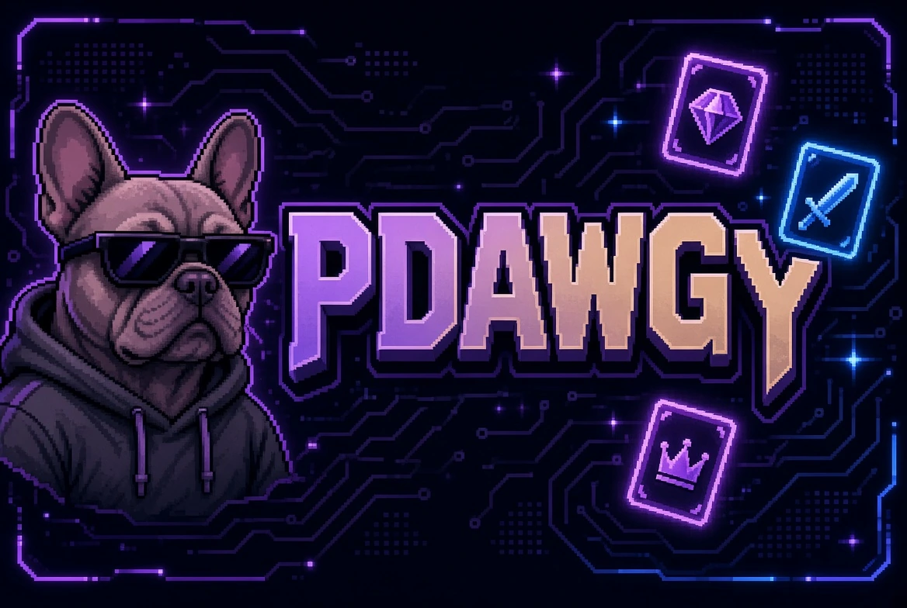
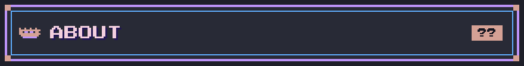
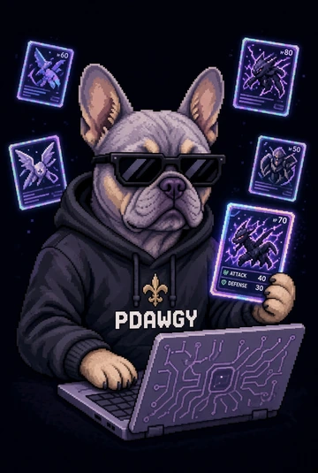
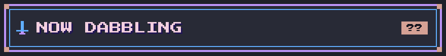
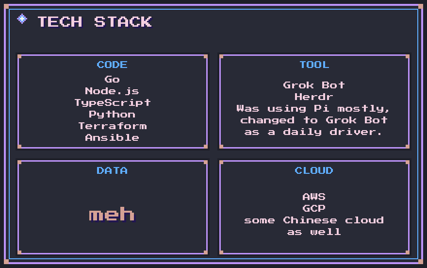
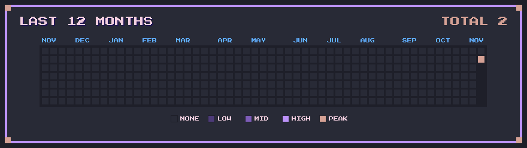
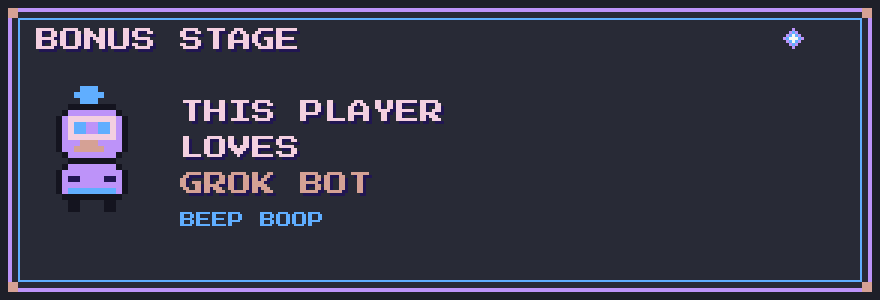
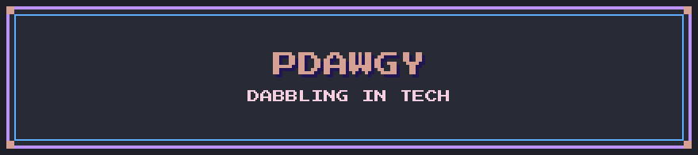

  

  

<table>
<tr>
<td width="360" valign="middle">

</td>
<td valign="middle">

I try to dabble in a bit of tech, writing my own projects, and would love to contribute to an open source project one day.

Maintaining a couple of websites. Was working as a devops engineer, but mostly do backend now.

</td>
</tr>
</table>

  

- Trying out Grok Bot, trying to achieve godlike PR counts like Lauren.
- \>.<
- TLA+

  

  

  

  

<!-- easter egg: this player loves grok bot -->
